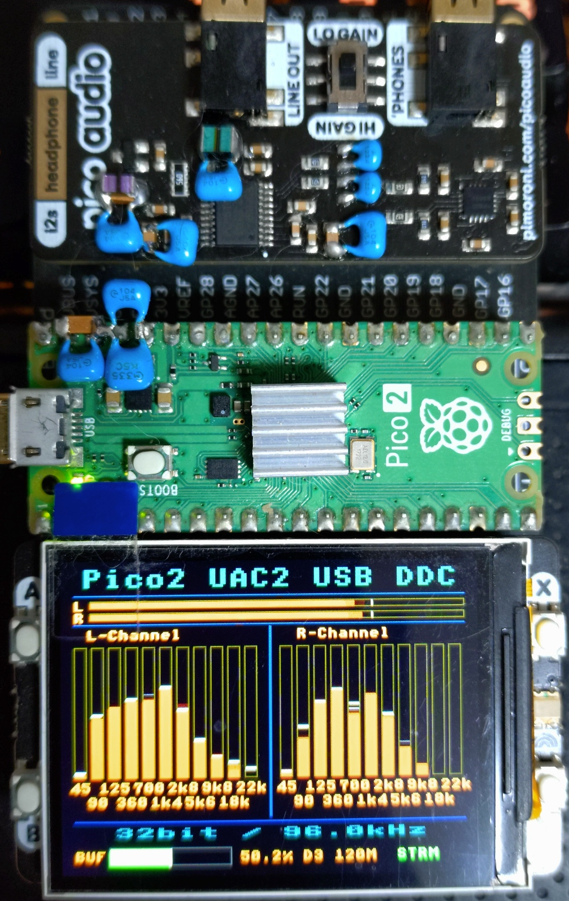

# Pico2_UAC2_USBDDC_VerFinal_11FFT_NoOverSampling (TinyUSB UAC2 Edition)

## Description
- Firmware for Raspberry Pi Pico 2 (RP2350) featuring an 11-band FFT spectrum display with a Hann window and A-weighting, plus a real-time buffer water-level monitor. It uses TinyUSB UAC2 with asynchronous feedback and does not use oversampling or FIR filtering.
- Operation has been verified with PCM5100 / PCM5102A on PICO_AUDIO_PACK hardware.
- **Build Verified**: Raspberry Pi Pico SDK v2.3.1 / Toolchain 15_2_Rel1

## 概要
- 本プロジェクトは、RP2350（Raspberry Pi Pico 2）上で動作する **USB Audio Class 2.0 (UAC2) 準拠** の USB-DDC（Digital to Digital Converter）です。
- 従来のLUFA由来のコードを完全に排除し、**TinyUSB UAC2** をベースとした **Async Feedback Endpoint** によるクロック同期（XMOS系制御思想に基づくRingBuffer水位安定化制御）を実装しています。
- USB経由で入力された2ch PCMオーディオ信号をオーバーサンプリングやFIRフィルタ処理を行わず、ビット深度32bitでI²Sインターフェイスへ出力します（NOS化）。
- LCDディスプレイ上に、**ハン窓およびA特性係数を適用したリアルタイム11バンドFFTスペクトラム表示**および**バッファー水位計**を搭載しています。
- **音声クリッピング対策を実装**
  ※DEFAULT_GAIN_RATIO = 0.80 を採用しています。
  0.70 / 0.75 / 0.80 / 0.83 / 0.85 / 1.00 の設定について、
  FFT測定および実音源による比較試聴を実施しました。
  FFT測定では、DEFAULT_GAIN_RATIO=0.80設定において

  100Hz
  THD 0.00104%
  THD+N 0.00743%

  1kHz
  THD 0.00231%
  THD+N 0.00696%

  20kHz
  THD 0.00971%
  THD+N 0.01650%

  を示し、高域特性も維持していました。
  試聴では、0.70および0.75は高域の抜けが不足し、0.83以上はよりクリアでしたが、筆者の試聴環境では刺激感が増す傾向がありました。
  透明度・高域の抜け・聴き心地・クリッピング余裕を総合評価した結果、本システムでは DEFAULT_GAIN_RATIO = 0.80 を実用最適値として採用しています。
  ※本結果はPICO_AUDIO_PACK（PCM5100A/PCM5102A）および筆者環境での評価結果であり、使用するDACや再生環境によって最適値は異なる可能性があります。

- **ビルド確認環境**: Raspberry Pi Pico SDK v2.3.1 / ツールチェーン 15_2_Rel1 にてビルド確認済み

## 特長
- **USB Audio Class 2.0 準拠 16/24/32bit PCM対応 (TinyUSB UAC2ベース)**
- **Async Feedback Endpoint による非同期フィードバック制御**
- **リアルタイム・バッファー水位計装備**（RingBufferの蓄積状況を視覚化）
- **A特性補正を適用した11バンドFFT表示**
- **音声クリッピング対策を実装**
- **SDK v2.3.1 / ツールチェーン 15_2_Rel1 対応**
- Raspberry Pi Pico 2 (RP2350) 専用
- No Oversampling (NOS)
- No FIR Filtering
- ダイレクトPCM出力
- DMA + PIOによる低遅延I²S伝送
- Dual Core RP2350対応
- PICO_AUDIO_PACK互換 / Pico Display Pack 2.0互換
- Foobar2000＋ASIO4ALLでのサンプルレート表示確認
  USB Audio Class 2.0により、ホスト側から指定されたサンプリングレートに応じて動作クロックを切り替えます。
  Foobar2000＋ASIO4ALL(Ver.2.22)で、再生レートに合わせて本機側の表示が切り替わることを確認しています。
  Windows側の出力サンプリングレート設定によっては、音切れが発生する組み合わせがあります。
  動作安定性は再生環境や設定によって異なるため、ご確認の上ご使用ください。

## Hardware Photo

### Complete System

Pico2 + Pico Audio Pack (PCM5100A) + Pico Display Pack 2.0

## 表示仕様（Pico Display Pack 2.0）
ディスプレイ上では、以下のリアルタイム情報およびオーディオビジュアライザーが描画されます。
- **L/R レベルメーター**: ステレオ音声の音量レベルをリアルタイム表示。
- **L・R 独立 11バンド FFT 表示**: A特性補正を適用した周波数スペクトラムを左右チャンネルそれぞれで11バンド分離表示。
- **バッファー水位計 (Buffer Water Level Meter)**: リングバッファの蓄積状態（中央維持状況、Overflow/Underflowのリスク等）をリアルタイム視覚化。
- **オーディオ情報表示**: 現在のビット深度およびサンプリング周波数 (Fs) をリアルタイム表示。
- **表示に関する注意**: L/Rピークメーターは入力音量に応じて先端が頻繁に更新されるため、ちらついて見える場合があります。これはピーク表示の動作によるものです。
- 分周値とフラッシュクロックを水位計の横に表示します。（例：D3 120M） 

## 対応OS
- Windows11
※Windows11　26H2にて動作確認済み
※android　動作対象外　使用したい場合は、"Pico2UltraHiResUSBDDC_VerFinal_11FFT_NoOverSampling"をご使用ください。

## 対応DAC
- TI PCM5100 / PCM5102A
※ PICO_AUDIO_PACK環境で動作確認済み

## USB入力仕様
- USB Audio Class 2.0 (Async Feedback)
- PCM、2chステレオ
- ビット深度・サンプルレート対応表（RP2350 Full-Speed帯域制約に基づく）：
  - **16bit**: 44.1kHz / 48kHz / 88.2kHz / 96kHz / 176.4kHz / 192kHz
  - **24bit**: 44.1kHz / 48kHz / 88.2kHz / 96kHz 
  - **32bit**: 44.1kHz / 48kHz / 88.2kHz / 96kHz 
※ 24bitおよび32bitの176.4kHz / 192kHz動作は未確認です。
※ 非対応または未確認フォーマット受信時の動作については検証中です。

## I²S出力仕様
- I²S 32bit PCM Format
- Stereo
- Input Sample Rate Follow Mode
- No Sample Rate Conversion
- No Oversampling
- Direct PCM Output
※ Windowsの音量調整がデジタル処理を行う場合があります。音量調整方法は再生環境に応じて設定してください。

## Playback Notes
- Windows側の出力レート設定によって音切れが出る組み合わせがあります。また再生時は、ご使用のPC環境や負荷状況により音切れが発生する場合があります。
- 音切れが発生する場合は、再生経路（ASIO、WASAPI等）を切り替えたり、再生ソフトウェアまたはOSのサンプリングレート設定を下げてご使用ください。
- Audio dropouts may occur with certain Windows output sample-rate settings. Dropouts may also depend on the host PC, system load, and playback configuration.
- If dropouts occur, try changing the playback path (e.g., ASIO or WASAPI) or lowering the sample rate in the audio player or operating system.

## FFT Spectrum Display & Buffer Monitor
### Real-time 11-band FFT spectrum analyzer (with Hann Window & A-Weighting) and Buffer Water Level Meter.
表示・解析デバイス: Pico Display Pack 2.0 (ドーターボード経由接続)
表示バンドの周波数:
- 45Hz
- 90Hz
- 125Hz
- 360Hz
- 700Hz
- 1.4kHz (1k4)
- 2.8kHz (2k8)
- 5.6kHz (5k6)
- 9.8kHz (9k8)
- 18kHz
- 22kHz

### Configuration:
- FFT_LEN = 2048
- Window Function: **Hann Window**
- Weighting: **A-Weighting (A特性係数適用)**
- RingBuffer Water Level Monitoring with Feedback Control
The LCD display provides a real-time 11-band spectrum visualization and buffer status optimized for RP2350 performance and low display latency.

## 使用技術・構成
- ハードウェア: RP2350 (Raspberry Pi Pico 2)
- 開発環境: **VSC環境　Raspberry Pi Pico SDK v2.3.1 / ツールチェーン 15_2_Rel1** (ビルド確認済み)
- 表示・解析デバイス: Pico Display Pack 2.0 (ドーターボード経由接続)
- データ転送:
  DMA + PIO による低遅延 I²S 出力
- マルチコア処理:
  Core0
  - LCD描画処理（FFT・バッファー水位計含む）
  - Power Mode管理
  - クロック切り替え制御（44.1kHz系: 336MHz / 48kHz系: 360MHz）
  - DACミュート制御
  - タイマー管理処理

  Core1
  - I²S出力処理
  - DMA転送処理
  - FFT解析処理（ハン窓・A特性演算含む）
- USB制御:
  **TinyUSB UAC2 (uac2_speaker_fb ベース)** および **Async Feedback クロック同期制御**
- タイミング制御:
  Repeating Timer による周期管理
- RAM実行とフラッシュクロック分周の設定
  プログラムをRAM上で実行。
  フラッシュクロックの分周値は3に設定。
  動作確認では、44.1/88.2kHz系で112MHz、48/96kHz系で120MHzと表示されました。

## ピンアサイン詳細
- I2S DATA : `GP9`
- I2S BCLK : `GP10`
- I2S LRCK : `GP11`
- I2C SDA  : `GP6`
- I2C SCL  : `GP7`
- DAC ENABLE : `GP5`
- POWERMODE SW : `GP0`
- Pico Display (SPI/Ctrl) : `GP16` - `GP20`
- Pico Display カラーLED : ピンアサインの衝突を防ぐため**停止状態（非使用）**に設定
- Pico Display ボタン (A, B, X, Y) : 未使用

## ビルド・使用方法
1. 機器の接続は**ドーターボード経由**で行ってください。
2. Visual Studio Code 上で Raspberry Pi Pico 拡張機能をインストールする。
  （※ **SDK 2.3.1 / ツールチェーン 15_2_Rel1** 環境でのビルドを推奨・確認済み）
3. 本リポジトリをクローンする。
4. VSCode上でビルドを実行する（`build/src` にバイナリが生成されます）。
5. Pico 2 の **BOOTSEL ボタン** を押しながらPCに接続し、ドライブ（`RP2350`）として認識させる。
6. 生成されたファームウェア（`.uf2`）をドラッグ＆ドロップして書き込む。
7. 接続後、OS標準のUSB Audio Class 2.0 デバイスとして自動認識されます。

### 改修に至った理由
- ノンオーバーサンプリング化とソフトウェアFIRフィルターの削除により、サンプルレート切り替え時のノイズ削減と周波数特性の改善を行っております。
- DAC側でオーバーサンプリング処理＆FIRフィルターが実装されており、必要ないとの判断に至ったため。
- 音声処理を簡素化し、USB入力信号をなるべく加工せずに出力する設計としました。
- 元ソースコード状態において、MCUがオーバークロック状態に設定されているため、オーバークロック動作への対策として、発熱を抑える目的でヒートシンクを取り付けています。
- さらに、USBオーディオの転送品質とクロック追従性を高めるため、LUFAを完全に排除し **TinyUSB UAC2 + Async Feedback 制御** へ刷新。視覚的な安定性を確認できる**バッファー水位計**の装備に加え、聴感特性に合わせた**ハン窓・A特性適用FFT表示**および音声クリッピング対策も完了しています。
- 開発環境についても **SDK v2.3.1 / ツールチェーン 15_2_Rel1** にて動作を確認。

## FFT測定による検証
- Ver7 変更内容

オーバーサンプリング関連コード削除

FIR関連コード削除

ES系DAC出力関連コード削除

I2C出力関連コード削除

信号経路および処理経路の整理

### Ver6との比較において、同一測定環境下で以下の変化を確認した。

### 測定結果
100Hz    Ver6       Ver7
THD    : 0.00104% → 0.00030%
THD+N  : 0.00743% → 0.00563%

1kHz
THD    : 0.00231% → 0.00141%
THD+N  : 0.00696% → 0.00508%

10kHz
THD    : 0.00996% → 0.00988%
THD+N  : 0.01889% → 0.01854%

20kHz
THD    : 0.00971% → 0.01585%
THD+N  : 0.01650% → 0.02701%

IMD (19kHz + 20kHz)
THD    : 0.01086% → 0.01040%
THD+N  : 0.04472% → 0.04454%

IMD差周波成分（1kHz）
-118.71dB → -121.09dB

※ハードウェア構成、測定環境、測定条件は同一であり、ファームウェアのみ変更。

### 試聴結果

Ver6と比較して、

濁り感の減少
素直で見通しの良い音調

を確認した。

### 考察

今回の変更では、信号経路および処理経路を簡素化した。

測定結果および試聴結果には変化が確認されたが、

- 信号経路短縮の効果
- 分岐条件削減の効果
- LUFA版とUAC2版の差異

を個別に切り分けた検証は実施していない。

そのため、

「信号経路短縮によって測定結果が改善した」

あるいは

「測定結果の改善が試聴結果の改善要因である」

とは断定できない。

一方、本比較ではハードウェア構成・測定環境・測定条件は同一であり、変更した要素はファームウェアのみである。

そのため、今回観測された測定結果および試聴結果の差は、ファームウェア変更によって生じたものであることが確認された。

ただし、ファームウェア内部のどの変更要素が結果に寄与したかについては、現時点では特定できていない。

なお、20kHzのTHDおよびTHD+NはVer6比で悪化傾向を示したが、本システムにおいては試聴上の問題は確認されなかった。

## ライセンス
- MIT License
- Additional modifications and implementation by Toshimiyu.

## 参考文献
- USB Audio Class 2.0 Specification
- TinyUSB Stack
- Raspberry Pi Pico SDK (v2.3.1)